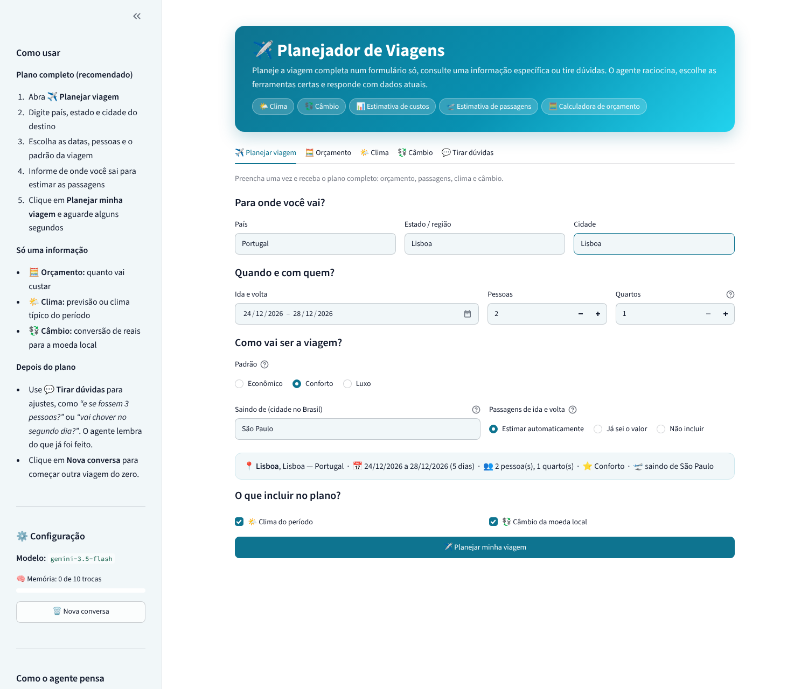

# ✈️ Planejador de Viagens — Agente Inteligente com LangChain + ReAct

Agente conversacional que ajuda a planejar viagens. Ele consulta o **clima** do destino no período da viagem, **converte moedas** com a cotação atual, pede ao **LLM (Gemini) estimativas de custos e de passagens** para a cidade, o mês e o padrão da viagem, e **calcula o orçamento** completo. Usa o framework **ReAct** para decidir sozinho quais ferramentas chamar e em que ordem, e tem **memória conversacional** para entender perguntas de acompanhamento ("e lá, vai chover?").

---

## 1. O problema

Planejar uma viagem exige juntar informações espalhadas em vários lugares:

- abrir um site de clima e procurar a cidade;
- abrir outro site para ver a cotação do dólar, euro ou peso;
- montar uma planilha para somar hospedagem, comida, transporte e passeios;
- converter o total para reais e refazer tudo a cada mudança de plano.

São tarefas simples, mas repetitivas, fáceis de errar e que tomam tempo.

**Público-alvo:** quem viaja a lazer, mochileiros, famílias e pequenas agências de turismo que querem respostas rápidas sem abrir várias abas.

## 2. A solução

Um agente em linguagem natural que recebe uma pergunta como:

> "Vou passar 4 dias em Buenos Aires com minha esposa. Hotel de US$ 90 a diária, US$ 45 por pessoa por dia de comida e US$ 150 de passeios. Quanto fica em reais e como vai estar o tempo?"

e, sozinho, **raciocina**, **escolhe as ferramentas**, **lê os resultados** e entrega uma resposta consolidada.

### Funcionalidades

| Funcionalidade | Como funciona |
|---|---|
| Clima do período | Tool `previsao_do_tempo` → Open-Meteo (gratuita, sem chave). Até 16 dias: previsão dia a dia. Mais longe: clima do mesmo período no ano anterior, como referência |
| Conversão de moedas | Tool `conversor_de_moedas` → AwesomeAPI (gratuita, sem chave), com conversão entre moedas estrangeiras usando o real como ponte |
| Estimativa de custos | Tool `estimativa_de_custos` → o **LLM (Gemini)** estima hospedagem, alimentação, transporte local e passeios para a cidade, o mês e o padrão (econômico, conforto ou luxo), e diz se é alta temporada. Saída estruturada (JSON validado com Pydantic), convertida para reais pela cotação **real** do dia |
| Estimativa de passagens | Tool `estimativa_passagens` → o **LLM (Gemini)** escolhe o meio de transporte (avião ou ônibus) e estima o preço de ida e volta por pessoa; o código valida e multiplica pelo grupo |
| Orçamento de viagem | Tool `calculadora_orcamento` → cálculo local com resumo da viagem, quartos, reserva para imprevistos, custo médio por dia, por pessoa e por pessoa/dia |
| Raciocínio ReAct | Ciclo *Thought → Action → Observation* até chegar à *Final Answer* |
| Memória | Janela das últimas N trocas, injetada no prompt |
| Interfaces | Web (Streamlit) com abas **Planejar viagem**, **Orçamento**, **Clima**, **Câmbio** e **Tirar dúvidas**, e linha de comando |

### A interface



Em todas as abas, País, Estado e Cidade são **campos de texto livres** (ex.: Peru → Cusco → Machu Picchu). A base `data/destinos.json` serve de apoio: quando o país está nela, o app usa o código do país para achar a cidade certa no clima e já sabe a moeda no câmbio. Para países fora da base, o clima busca pelo nome e o próprio LLM identifica a moeda local.

- **✈️ Planejar viagem:** um formulário único, dividido em áreas: destino; datas, pessoas e quartos; padrão, cidade de origem e passagens (estimar, informar ou não incluir); e o que incluir (clima e câmbio). Um botão gera o relatório completo: o agente encadeia `estimativa_de_custos` → `estimativa_passagens` → `calculadora_orcamento` → `previsao_do_tempo` → `conversor_de_moedas` e escreve resumo, orçamento, clima, câmbio e dicas.
- **🧮 Orçamento:** os mesmos campos de viagem, só para o orçamento (custos → passagens → calculadora).
- **🌤️ Clima:** País, Estado, Cidade e o período.
- **💱 Câmbio:** país de destino (define a moeda), valor e direção (reais ↔ moeda local).
- **💬 Tirar dúvidas:** chat livre. Mostra todo o histórico, inclusive o que veio das outras abas, e serve para perguntas de acompanhamento ("e se fossem 3 pessoas?", "vai chover no segundo dia?").

Os formulários **não fazem os cálculos sozinhos**: eles só montam uma pergunta bem estruturada para o mesmo agente ReAct. Por isso tudo entra na memória e o usuário pode continuar no chat ("e se fossem 3 pessoas?").

### Arquitetura

```
Usuário ──► Interface (app.py / cli.py)
                 │
                 ▼
        TravelPlannerAgent (agent.py)
        ├── LLM: Gemini ou OpenAI (config.py)
        ├── Memória conversacional (memory.py)
        └── AgentExecutor ReAct ──► Tools (tools/)
                                    ├── previsao_do_tempo     → Open-Meteo (previsão + histórico)
                                    ├── conversor_de_moedas   → AwesomeAPI
                                    ├── estimativa_de_custos  → LLM (saída estruturada) + câmbio real
                                    ├── estimativa_passagens  → LLM (saída estruturada)
                                    └── calculadora_orcamento (local)
```

### Estrutura do repositório

```
Tp3_Planejamento_de_viagens/
├── app.py                  # Interface web (Streamlit)
├── cli.py                  # Interface de linha de comando
├── agent.py                # Lógica do agente: prompt ReAct + AgentExecutor + memória
├── memory.py               # Memória conversacional com janela deslizante
├── config.py               # Escolha e configuração do LLM (Gemini/OpenAI)
├── destinations.py         # Leitura da base de destinos (países, estados, cidades)
├── data/
│   └── destinos.json       # 12 países, estados e cidades (listas dos formulários), código e moeda
├── tools/
│   ├── __init__.py         # get_all_tools()
│   ├── http_client.py      # GET com timeout e erros padronizados
│   ├── input_cleaning.py   # Limpa entradas do LLM (aspas, restos do formato ReAct)
│   ├── weather.py          # Tool 1: clima (previsão ou histórico)
│   ├── currency.py         # Tool 2: conversor de moedas
│   ├── budget.py           # Tool 3: calculadora de orçamento
│   ├── llm_estimator.py    # Chamada ao LLM com saída estruturada (Pydantic) + cache
│   ├── reference_costs.py  # Tool 4: custos no destino estimados pelo LLM
│   └── fares.py            # Tool 5: passagens estimadas pelo LLM
├── .streamlit/config.toml  # Tema da interface
├── tests/                  # 58 testes automatizados (pytest, rodam offline)
│   ├── test_tools.py       # ferramentas (APIs e LLM simulados)
│   ├── test_agent.py       # ciclo ReAct, memória e proteções
│   └── test_destinations.py
├── scripts/
│   └── run_use_cases.py    # Roda os casos de uso no LLM real e gera relatório
├── docs/                   # Relatório dos casos de uso com o LLM real + imagens
├── requirements.txt
└── .env.example
```

---

## 3. Configuração do LangChain e escolha do LLM

| Item | Escolha | Por quê |
|---|---|---|
| Framework | LangChain 1.x (`langchain`, `langchain-core`, `langchain-classic`) | `create_react_agent` + `AgentExecutor` (em `langchain-classic`) implementam o ReAct clássico em texto, com *Thought/Action/Observation* visíveis, o que é ótimo para acompanhar e explicar o raciocínio |
| LLM padrão | **Google Gemini** (`gemini-3.5-flash`) via `langchain-google-genai` | Tem plano gratuito, responde bem em português, é rápido (família Flash) e suporta **saída estruturada**, usada nas ferramentas de estimativa |
| Alternativa | OpenAI (`gpt-4o-mini`) via `langchain-openai` | Basta trocar `LLM_PROVIDER=openai` no `.env`: o resto do código não muda |
| Temperatura | `0.1` | Respostas mais consistentes, que seguem o formato ReAct e repetem as mesmas estimativas |

Toda a configuração fica em `config.py`: ele lê o `.env` (provedor, modelo, chave e tamanho da memória), valida a chave e devolve o objeto de chat do LangChain. O agente (`agent.py`) recebe esse LLM e o usa em dois papéis: como **cérebro do ReAct** e dentro das **ferramentas de estimativa**.

```python
# config.py (resumo)
llm = ChatGoogleGenerativeAI(model="gemini-3.5-flash", temperature=0.1, google_api_key=...)

# agent.py (resumo)
agent = create_react_agent(llm=llm, tools=get_all_tools(llm), prompt=REACT_PROMPT, output_parser=TolerantReActParser())
executor = AgentExecutor(agent=agent, tools=tools, max_iterations=12, handle_parsing_errors=..., return_intermediate_steps=True)
```

---

## 4. Como o ReAct funciona aqui

O prompt (em `agent.py`) instrui o LLM a seguir este formato:

```
Question: Quanto são 1500 euros em reais?
Thought: Preciso da cotação atual do euro.
Action: conversor_de_moedas
Action Input: 1500 EUR para BRL
Observation: 1,500.00 EUR = 9,450.00 BRL (cotação atual: 1 EUR = 6.3000 BRL).
Thought: Agora sei a resposta final.
Final Answer: 1.500 euros valem cerca de R$ 9.450,00 pela cotação de hoje.
```

*(valores ilustrativos)*

O `AgentExecutor` do LangChain executa o ciclo: quando o LLM escreve `Action`, a ferramenta é chamada e o resultado volta como `Observation`; o ciclo repete até a `Final Answer`. Proteções implementadas:

- **`max_iterations=12`**: impede loops infinitos (o plano completo usa 5 ferramentas);
- **`handle_parsing_errors`**: se o LLM sair do formato, recebe uma instrução de correção e tenta de novo;
- **Observação inventada é rejeitada**: se o LLM escrever um "Observation:" sozinho, sem chamar a ferramenta (aconteceu com o Gemini nos testes), a resposta é recusada e ele é instruído a chamar a ferramenta de verdade;
- **Orçamento sempre calculado**: nas abas Planejar viagem e Orçamento, se o agente terminar sem usar a `calculadora_orcamento`, a interface pede automaticamente que ele conclua a conta;
- **Ferramentas nunca lançam exceção para o agente**: devolvem uma mensagem de erro em texto, para que o agente possa corrigir a entrada ou explicar o problema ao usuário.

### Memória

`memory.py` guarda as últimas `MEMORY_WINDOW` trocas (padrão: 10) como `HumanMessage`/`AIMessage`. A cada pergunta, o histórico é inserido no prompt (`{chat_history}`). Isso permite perguntas como "e quanto dá na moeda de lá?" sem repetir o destino. A janela limita o tamanho do prompt, o custo e o uso do contexto do modelo.

---

## 5. Ferramentas

| Nome | Descrição (o que o LLM lê) | Entrada | Função |
|---|---|---|---|
| `previsao_do_tempo` | Previsão dia a dia (até 16 dias) ou clima típico do período (mais longe) | `"Lisboa"` ou `"Gramado, BR \| 2027-07-10 \| 2027-07-15"` | `get_weather_forecast` |
| `conversor_de_moedas` | Converte valores pela cotação atual | `"250 EUR para BRL"` | `convert_currency` |
| `estimativa_de_custos` | LLM estima custos médios da cidade (padrão e mês) e a temporada; converte pela cotação real | `"Lisboa, Portugal \| conforto \| 7 \| BRL"` | `make_reference_costs_tool(llm)` |
| `estimativa_passagens` | LLM estima ida e volta por pessoa (avião ou ônibus); total do grupo | `"São Paulo, Brasil \| Lisboa, Portugal \| 2 \| 7 \| conforto"` | `make_fares_tool(llm)` |
| `calculadora_orcamento` | Orçamento com resumo, quartos, categorias, 10% de reserva, médias por dia/pessoa | JSON: `{"destino": "...", "dias": 5, "pessoas": 2, "hospedagem_diaria": 400, ...}` | `calculate_trip_budget` |

### O que o LLM faz × o que o código faz

| Quem | Responsabilidade |
|---|---|
| **LLM (Gemini)** | Entende a pergunta, decide quais ferramentas usar (ReAct), **estima custos e passagens** (ferramentas 4 e 5) e escreve a resposta final |
| **APIs reais** | Clima (Open-Meteo) e câmbio (AwesomeAPI) |
| **Código Python** | Valida as estimativas do LLM (formato e faixa de valores), converte moedas e **faz todas as contas** do orçamento |

As ferramentas de estimativa usam `llm.with_structured_output(...)`: o Gemini precisa devolver um JSON com campos fixos (ex.: `hospedagem_noite_usd`, `alta_temporada`, `justificativa`), validado com Pydantic. Assim o número vem do conhecimento do modelo, mas num formato que o código confere antes de usar. As respostas ficam em **cache** durante a sessão, então a mesma pergunta dá os mesmos números.

> ⚠️ **Sobre as estimativas:** custos e passagens são **estimativas do modelo de linguagem**, para planejamento. Não são preços reais de hotéis ou companhias aéreas e podem variar entre execuções. A justificativa do modelo aparece no raciocínio para facilitar a conferência.

Cada tool é um `langchain_core.tools.Tool` com `name`, `description` e `func` definidos explicitamente.

---

## 6. Como executar

### Pré-requisitos
- Python 3.10 ou superior
- Uma chave de API de **um** dos provedores:
  - Gemini: https://aistudio.google.com/apikey (tem plano gratuito)
  - OpenAI: https://platform.openai.com/api-keys

### Passo a passo

```bash
# 1. Clonar o repositório
git clone https://github.com/PoddaC/Tp3_Planejamento_de_viagens.git
cd Tp3_Planejamento_de_viagens

# 2. Criar e ativar um ambiente virtual
python -m venv .venv
source .venv/bin/activate        # Windows: .venv\Scripts\activate

# 3. Instalar as dependências
pip install -r requirements.txt

# 4. Configurar a chave
cp .env.example .env             # Windows: copy .env.example .env
# edite o .env: LLM_PROVIDER=gemini e GOOGLE_API_KEY=...

# 5a. Interface web
streamlit run app.py

# 5b. ou linha de comando
python cli.py
```

Na interface web, use **Planejar viagem** para o plano completo, **Orçamento**, **Clima** e **Câmbio** para uma informação específica, e **Tirar dúvidas** para perguntar livremente.

Comandos da CLI: `/limpar` (nova conversa), `/passos` (mostra/oculta o raciocínio), `/sair`.

### Testes

```bash
pytest -v                          # 58 testes, rodam offline (APIs e LLM simulados)
python scripts/run_use_cases.py    # casos de uso no LLM real → docs/resultados_casos_de_uso.md
```

---

## 7. Casos de uso

| ID | Caso de uso | Exemplo de pergunta | Comportamento esperado |
|---|---|---|---|
| UC1 | Clima do destino | "Vou para Lisboa nos próximos 5 dias. Como vai estar o tempo? O que levo na mala?" | Usa `previsao_do_tempo` e sugere roupas |
| UC2 | Conversão de moeda | "Tenho 1500 euros. Quanto vale em reais hoje?" | Usa `conversor_de_moedas` |
| UC3 | Orçamento com custos informados | "5 dias em Gramado, 2 pessoas, pousada R$ 450, R$ 150/pessoa/dia de comida..." | Monta o JSON e usa `calculadora_orcamento` |
| UC4 | Plano completo (aba Planejar viagem) | Lisboa, julho, 2 pessoas, padrão conforto, saindo de São Paulo, com clima e câmbio | Encadeia `estimativa_de_custos` (LLM indica a temporada) → `estimativa_passagens` → `calculadora_orcamento` → `previsao_do_tempo` → `conversor_de_moedas` |
| UC5 | Memória | "Vou para Santiago." → "Como vai estar o tempo **lá**?" → "Converta 2000 reais para a **moeda local**." → "Qual é o meu destino?" | Resolve as referências usando o histórico |
| UC6 | Erros | "Previsão em Xptozlândia? E 100 ABC em reais?" | Ferramentas avisam o erro; o agente explica em vez de inventar |
| UC7 | Planejamento em dólar | "4 dias em Buenos Aires... US$ 90 a diária... quanto fica em reais e como vai estar o tempo?" | Encadeia orçamento → câmbio → clima |

### Resultados observados

**Testes automatizados (`pytest`): 58 de 58 passando.** Eles cobrem:

- **Base de destinos**: todo país tem moeda, código e cidades em todos os estados.
- **Clima**: escolha entre previsão (até 16 dias) e histórico (mais longe), filtro por país, datas inválidas (passadas, invertidas, formato errado, período longo demais).
- **Estimativas pelo LLM** (com um LLM simulado que devolve JSON): o prompt leva cidade, mês e padrão; conversão dos custos pela cotação real; cache (mesma pergunta não chama o LLM de novo); rejeição de valores absurdos; falha do LLM vira mensagem amigável; total das passagens = preço por pessoa × grupo.
- **Ferramentas**: interpretação da entrada, cálculos (ex.: 5 dias, 2 pessoas → subtotal R$ 6.000 + 10% = **R$ 6.600**, ou R$ 3.300 por pessoa), conversão com ponte pelo real (1 EUR = 6 BRL e 1 USD = 5 BRL → 100 EUR = **120 USD**), cidade inexistente, moeda inválida, JSON malformado, valores negativos e falha de rede.
- **Agente ReAct** (com LLM simulado): uso de uma ferramenta; **encadeamento de duas ferramentas** na mesma pergunta; resposta aceita mesmo quando o LLM esquece o prefixo "Final Answer:" (comum no Gemini); recuperação quando o formato da ação vem quebrado; falha do LLM sem derrubar a aplicação.
- **Memória**: a segunda pergunta chega ao LLM com a primeira troca no prompt; a janela descarta as trocas mais antigas.
- **Robustez a erros reais do Gemini**: observação inventada pelo modelo é recusada; texto do formato ReAct que "vaza" para a entrada da ferramenta (ex.: `BRL Obervation:`) é limpo.

**Execução com o LLM real** (`gemini-3.5-flash`, 24/11/2026). Rode `python scripts/run_use_cases.py` para todos os casos ou `python scripts/run_use_cases.py UC7` para casos específicos. O relatório completo, com cada *Thought/Action/Observation*, fica em `docs/`. Resumo:

| Caso | Ferramentas usadas | Tempo | Resultado |
|---|---|---|---|
| UC1 — Clima | `previsao_do_tempo` | 8,8 s | ✅ Previsão de 5 dias para Lisboa (chuva no 1º dia) e sugestões de mala coerentes (camadas, guarda-chuva, sapato antiderrapante) |
| UC2 — Câmbio | `conversor_de_moedas` | 4,6 s | ✅ 1.500 EUR = R$ 9.707,40 (1 EUR = 6,4716 BRL) |
| UC3 — Orçamento informado | `calculadora_orcamento` | 7,7 s | ✅ Montou o JSON certo; total R$ 5.610,00 (R$ 2.805 por pessoa), apresentado em tabelas |
| UC4 — Plano completo | `previsao_do_tempo`, `conversor_de_moedas`, `estimativa_passagens`, `estimativa_de_custos`, `calculadora_orcamento` (+4 conversões extras) | 145 s | ✅ com ressalvas: total de R$ 30.855,72 para Lisboa em julho, passagens estimadas em R$ 7.500/pessoa (alta temporada), clima típico de 26 °C. O Gemini **inventou observações 2 vezes** e a proteção recusou as duas. Um texto que vazou para a entrada (`BRL Obervation:`) fez os custos voltarem em USD, e o agente se recuperou convertendo valor por valor (bug corrigido depois) |
| UC5 — Memória | nenhuma → `previsao_do_tempo` → `conversor_de_moedas` → nenhuma | 67 s (4 msgs) | ✅ Entendeu "lá" = Santiago e "moeda local" = CLP; na última pergunta respondeu só pela memória: destino e R$ 2.000 = 352.920 CLP |
| UC6 — Erros | `previsao_do_tempo`, `conversor_de_moedas` | 53,6 s | ✅ Recebeu "cidade não encontrada" e "moeda não suportada" e explicou ao usuário, sem inventar dados |
| UC7 — Planejamento em dólar | — | — | ⏳ Não executado: a **cota diária do plano gratuito do Gemini (20 requisições)** acabou. Rodar de novo com `python scripts/run_use_cases.py UC7` |

**O que os testes reais mostraram:**
- Perguntas diretas (UC1, UC2, UC3) são rápidas (5–9 s) e precisas.
- O plano completo (UC4) funciona, mas é caro em chamadas. Foram 2 respostas inventadas pelo modelo, rejeitadas pelo parser. Isso confirmou na prática que as proteções do ReAct eram necessárias.
- A memória (UC5) e o tratamento de erros (UC6) funcionaram como esperado.
- O plano gratuito do Gemini limita bastante o uso: o UC4 sozinho consumiu cerca de metade da cota diária.

---

## 8. Reflexão: agente × abordagem manual

**Sem o agente**, o plano completo do UC4 (Lisboa em julho) exigiria:

1. Pesquisar passagens São Paulo → Lisboa em sites de companhias ou buscadores;
2. Pesquisar hotéis, preços de restaurantes, transporte e passeios em Lisboa para julho;
3. Descobrir se julho é alta temporada;
4. Abrir um site de clima e ver o clima típico de julho;
5. Abrir um site de câmbio e anotar a cotação do euro;
6. Montar uma planilha com noites × diária, pessoas × dias × gastos diários, passagens e reserva;
7. Refazer tudo a cada mudança ("e se forem 3 pessoas?", "e se for em setembro?").

São de 5 a 6 sites, uma planilha e de 30 minutos a algumas horas de pesquisa, com risco de erro de conta ou de cotação desatualizada. No UC7 (Buenos Aires, com custos já conhecidos), ainda seriam 2 sites e uma planilha.

**Com o agente**, basta uma frase. Ele:

- **decide sozinho** o que consultar e em que ordem (ReAct), sem um fluxo fixo programado para cada tipo de pergunta;
- usa **dados atuais** (cotação e clima do dia) em vez do conhecimento congelado do modelo;
- **substitui a pesquisa de preços**: em vez de procurar hotéis, restaurantes e passagens em vários sites, o LLM dá uma estimativa média, com justificativa, para qualquer cidade, mês e padrão;
- faz as **contas de forma determinística** na calculadora: o LLM estima, mas quem soma é o código;
- **lembra o contexto**, então "e se forem 5 dias?" refaz o cálculo sem repetir os dados;
- **mostra o raciocínio** na interface, o que permite conferir de onde veio cada número.

**O que o agente possibilita** e um script tradicional não faria bem: entender pedidos em linguagem livre, com dados faltando ou em qualquer ordem, e combinar ferramentas conforme a necessidade. Um programa comum exigiria formulários rígidos ou uma regra para cada combinação de pergunta.

**Limitações observadas:**
- O LLM pode errar a montagem do JSON ou interpretar um valor de forma diferente (ex.: diária por pessoa × por quarto). As descrições detalhadas das tools e as mensagens de erro reduzem isso.
- Cada pergunta gera várias chamadas ao LLM, então é mais lento e custa mais do que uma calculadora.
- Depende das APIs externas; se estiverem fora do ar, o agente avisa em vez de inventar.
- A memória é de sessão: ao fechar a aplicação, o histórico é apagado.
- **Cota do plano gratuito do Gemini**: há um limite baixo de requisições por dia (20 para o modelo usado nos testes). Um plano completo usa de 7 a 13 chamadas. Para uso contínuo, troque `LLM_MODEL` por um modelo com cota maior ou ative o faturamento.
- O Gemini às vezes inventa resultados de ferramentas ou mistura texto do formato ReAct na entrada. As proteções corrigem isso, mas cada nova tentativa custa uma chamada.

---

## 9. Boas práticas adotadas

- **Modularidade**: interface, agente, memória, configuração e cada ferramenta em arquivos separados. Para trocar o LLM, basta mudar o `.env`.
- **Tratamento de erros** em todas as camadas: timeout e erros HTTP centralizados em `http_client.py`; validação de entrada nas tools; `ConfigError` para chaves ausentes; captura de falhas do LLM em `agent.ask()`; limite de iterações e correção de formato no ReAct.
- **Nomes descritivos** e *type hints*; docstrings curtas explicando o porquê das decisões.
- **Testes offline** com *mocks* das APIs e LLM simulado (`FakeListChatModel`).
- **Segurança**: a chave fica no `.env`, que está no `.gitignore`.

## Tecnologias

LangChain 1.x (`langchain-classic` para o `create_react_agent`/`AgentExecutor`), Gemini ou OpenAI, Streamlit, Open-Meteo, AwesomeAPI e pytest.
